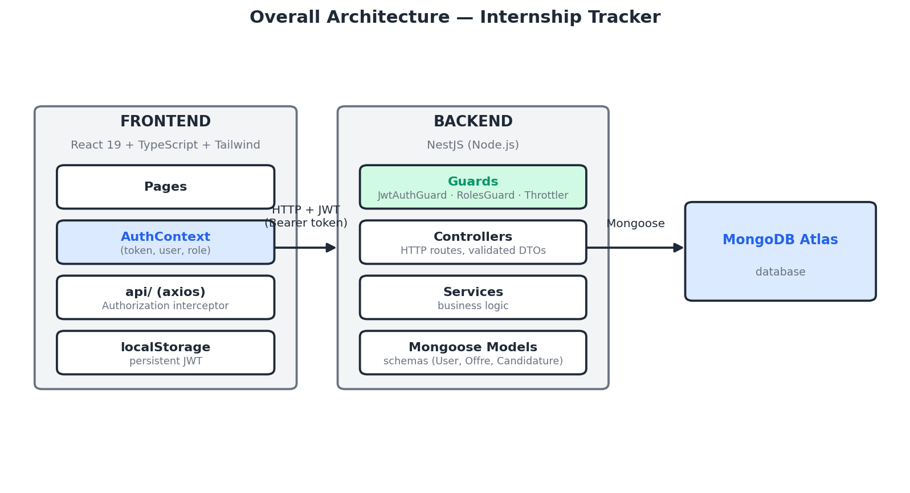

# Internship Tracker

A full-stack application for managing internship applications, built as a flagship project during a final-year internship (PFE) search. A candidate browses listings, applies, and tracks the status of their applications; an admin manages the listings and views a statistics dashboard.

## Table of contents

- [Features](#features)
- [Tech stack](#tech-stack)
- [Architecture](#architecture)
- [Data model](#data-model)
- [Installation](#installation)
- [Running the tests](#running-the-tests)
- [API documentation](#api-documentation)
- [Security](#security)
- [Quality & results](#quality--results)
- [Roadmap](#roadmap)
- [License](#license)

## Features

- JWT authentication with two roles (candidate / admin)
- Listings page with filters (type, duration, city) and pagination
- Listing detail page with one-click application
- User profile: edit personal info, upload CV and cover letter
- Application tracking with status (sent → interview → accepted / rejected)
- Admin area: full CRUD on listings, statistics dashboard
- Interactive API documentation (Swagger)

## Tech stack

| Layer | Technologies |
|---|---|
| Frontend | React 19, TypeScript, Tailwind CSS v4, React Router, Axios |
| Backend | NestJS 12, TypeScript, Mongoose, Passport-JWT, class-validator |
| Database | MongoDB Atlas |
| Testing | Vitest (backend), Vitest + React Testing Library (frontend), Playwright (e2e) |
| Quality / security | Helmet, @nestjs/throttler, bcrypt, ESLint, Swagger/OpenAPI |

## Architecture



The frontend calls the backend through Axios, attaching the JWT in the `Authorization` header. The backend verifies that token and the user's role on every protected route, then talks to MongoDB through Mongoose.

## Data model

**User** — email, password (hashed), role (`candidat` / `admin`), first name, last name, phone, CV, cover letter

**Offre** (listing) — company, title, description, type (on-site / hybrid / remote), duration, city, publication date

**Candidature** (application) — user, listing, status (`sent` → `interview` → `accepted` / `rejected`), date, notes

## Installation

### Prerequisites

- Node.js 24+
- A MongoDB cluster (Atlas or local)

### Backend

```bash
cd backend
npm install
```

Create a `.env` file at the root of `backend/` with the following variables (set your own values — this file must never be committed):

```
MONGODB_URI=
JWT_SECRET=
PORT=3000
```

Start the server:

```bash
npm run start:dev
```

### Frontend

```bash
cd frontend
npm install
npm run dev
```

The app is served on `http://localhost:5173` and calls the backend on `http://localhost:3000` (currently hardcoded in `src/api/client.ts` — see [Roadmap](#roadmap)).

## Running the tests

**Backend** (Vitest):

```bash
cd backend
npm run test        # unit tests
npm run test:cov    # with coverage
```

**Frontend** (Vitest + React Testing Library):

```bash
cd frontend
npm run test        # unit and component tests
npm run test:cov    # with coverage (via vitest.config.ts)
```

**End-to-end tests** (Playwright, requires both backend and frontend running):

```bash
cd frontend
npx playwright test
```

## API documentation

Once the backend is running, interactive Swagger documentation is available at `http://localhost:3000/api`, with built-in Bearer authentication to test protected routes directly from the UI.

## Security

Measures aligned with the OWASP Top 10:

- `Helmet` for secure HTTP headers
- Rate limiting (`@nestjs/throttler`, 10 req/min/IP) against brute-force attacks
- Passwords hashed with `bcrypt`
- User role always enforced server-side, never trusted from the client
- Dedicated `/users/me` route (instead of a generic `PATCH /users/:id`) with a restricted DTO, preventing privilege escalation
- Strict input validation (`class-validator`) on every DTO
- Secrets kept in environment variables, never committed

## Quality & results

- **Test coverage**: 84.73% backend (Vitest), 93.63% frontend (Vitest + React Testing Library)
- **Playwright e2e tests**: 3 critical flows (registration, application with the mandatory-CV business rule, full admin CRUD)
- **Lighthouse** (mobile, production build): 99 Performance / 100 Accessibility / 100 Best Practices
- **Accessibility**: labels associated with every form field, `aria-label` on filters and file inputs

## Roadmap

Built in phases. Phase 1 (MVP + quality layer) is complete; next up:

- [ ] Externalize the frontend's `API_BASE_URL` into a Vite environment variable
- [ ] Dockerization (multi-stage builds) + `docker-compose`
- [ ] CI/CD with GitHub Actions (lint, tests, build, Trivy vulnerability scan, deployment)
- [ ] Infrastructure as Code with Terraform on AWS (free tier)
- [ ] Deployment to a hardened Ubuntu server (nginx reverse proxy, HTTPS, automated backups)
- [ ] Prometheus/Grafana monitoring
- [ ] Kubernetes orchestration (k3s + Helm)

## License

MIT — see the [LICENSE](LICENSE) file.

---

Built by [Yossra Manai](https://github.com/manaiyossra) as part of a final-year internship (PFE) search.
